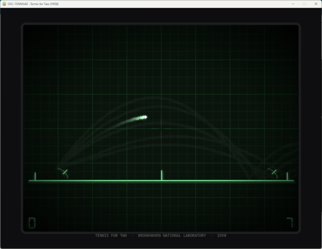

 

# OSC-TENNIS42

A pygame recreation of **Tennis for Two** — the first interactive electronic game,
built by physicist William Higinbotham at Brookhaven National Laboratory and shown
to visitors on **October 18, 1958**, rendered on a DuMont lab oscilloscope.

This project recreates both the *game* (side-view tennis, three vector elements:
ground line, net, ball) and the *look* (glowing P1-phosphor traces, persistence
trails, bloom, etched graticule, vignette, bezel).

## Run

```cmd
pip install -r requirements.txt
python main.py
```

Requires Python 3.10+ and pygame (2.6+ / pygame-ce 2.5+).

### Bot player

Play against the computer (it aims by forward-simulating the same physics engine —
a nod to the Donner Model 30 the original ran on):

```cmd
python main.py --bot-player        # computer plays Player 1 (left)
python main.py --bot-player 2      # computer plays Player 2 (right)
```

The bot simulates a fan of candidate dial angles each time the ball is committed
to its side, rejects shots that would clip the net or land out, picks the landing
depth it wants, rotates its dial there, and swings when aimed (with panic volleys
if the ball is about to die or escape reach).

## Controls

| Action            | Player 1 (left) | Player 2 (right) |
| ----------------- | --------------- | ---------------- |
| Aim (rotate dial) | `A` / `D`       | `←` / `→`        |
| Hit / Serve       | `Left Shift`    | `Right Shift`    |
| Toggle graticule  | `G`             | `G`              |
| Reset match       | `R`             | `R`              |
| Quit              | `Esc`           | `Esc`            |

**Rules:** hit the ball while it's on your side below reach height. A ball that
settles on your side gives the opponent a point; a ball landing beyond the end
line or leaving the screen gives the *opponent of the last hitter* a point.
The loser of each point serves. First to 11 (win by 2).

## Aiming

Each player has a **dial** that sets the launch angle of their shot (10°–80° above
horizontal, toward the opponent). The ball always leaves at a fixed speed (15 m/s) —
**only the angle changes the shot**. A small protractor arc near your baseline shows
the current dial position.

Measured first-bounce distances from the net (a serve from your baseline at 15 m/s):

| Dial angle | Ball lands           | Reading                                                     |
| ---------- | -------------------- | ----------------------------------------------------------- |
| 10–20°     | net or your own side | too flat — clears the net tape only above ~15°              |
| 30°        | 8.4 m in             | deep, fast — hard to return                                 |
| **45°**    | **9.8 m in**         | **sweet spot — lands deep near the opponent's baseline**    |
| 60°        | 6.8 m in             | mid-court lob, slow and floaty (drag bends the arc)         |
| 80°        | 2.5 m in             | near-vertical lob — drops almost straight down past the net |

Notes:

- The arc is **not** a textbook parabola — quadratic air drag (Donner Model 30
  emulation) pulls steep shots down early, so the maximum range sits at ~45°,
  not 45°+ as in vacuum physics.
- There is **no ceiling**: shots above ~70° fly off the top of the screen and
  drop back in — a legitimate (and very 1958) way to buy time.
- While the ball is dead on your side you can still rotate the dial before serving.

## Project layout

```
OSC-TENNIS42.md      spec & design document
settings.py          all tunable constants (single source of truth)
physics.py           pure simulation — gravity, quadratic air drag, bounces, net
crt.py               oscilloscope renderer (persistence, bloom, graticule, vignette)
game.py              match logic: states, hits, scoring, serving
bot.py               computer player — aims by forward-simulating physics
input.py             keyboard input with edge detection
main.py              entry point — fixed-timestep loop (120 Hz sim / 60 FPS render)
smoke_test.py        headless verification (add --bot for Bot vs scripted P2)
tests/test_physics.py  physics unit tests
```

## Testing

```cmd
python -m pytest tests/test_physics.py -q   # physics: 10 tests, headless
python -u smoke_test.py                     # full game loop with two bots
```

## Design notes

- **Physics** emulates the Donner Model 30 analog computer: semi-implicit Euler at
  a fixed 1/120 s tick with quadratic air drag (`a = -k·|v|·v`). `physics.py` has
  no pygame dependency and is fully deterministic.
- **Rendering** never clears the trace buffer — it multiplies it down each frame
  (×0.85), producing authentic phosphor persistence trails. Bloom is a cheap
  downscale→upscale additive pass; the graticule and vignette are pre-rendered.
- **No ceiling:** the ball can exit the top of the screen and fall back in —
  just like the original.
- **Documented deviations** from the 1958 original (score digits, dial indicator
  arcs, keyboard instead of knob controllers) are listed in the spec, §7.

## Stretch goals (1959 mode)

Serve-force charging button, 17″ display mode, and the original's party trick —
a **gravity selector** (Moon / Mars / Earth).
